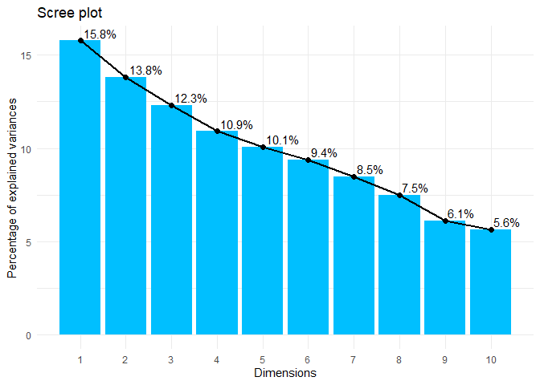

<!-- README.md is generated from README.Rmd. Please edit that file -->

# PCA

<!-- badges: start -->

[](https://github.com/trippzac/PCA/actions/workflows/R-CMD-check.yaml)
[](https://app.codecov.io/gh/trippzac/PCA)
<!-- badges: end -->

## Overview

The goal of PCA is to recreate the functionality of built-in functions
for principal component analysis using my own code. Specifically, we
provide two functions `PCA()` and `PCA_using_SVD()` that implement
principal component analysis by computing eigenvectors and by computing
singular values respectively. These are analogous to how each of the two
built-in functions `prcomp()` and `princomp()` work (though we compare
both of our functions to `prcomp()` for simplicity of testing).
Additionally, we provide two additional functions
`variance_explained_by_PCA()` and `scree_plot()` to help the user
analyze which principal components they may wish to keep in their
analysis. These functions are analogous to the functions found in the
library “factoextra”.

## Installation

You can install the development version of PCA like so:

``` r
devtools::install_github("trippzac/PCA", build_vignettes = T)
```

## Usage

This is a basic example of how to use PCA. Its use and output is similar
to that of the built-in function `prcomp()`

``` r
library(PCA)
set.seed(17)
y <- matrix(rnorm(101*10), 101, 10)
PCA(y)
#> $sdev
#>  [1] 1.2560188 1.1751101 1.1102199 1.0442849 1.0031343 0.9684830 0.9212839
#>  [8] 0.8659167 0.7821339 0.7509109
#> 
#> $rotation
#>              PC1         PC2          PC3          PC4         PC5         PC6
#>  [1,]  0.3095113 -0.26273653  0.552609662  0.236591405  0.05063261 -0.04849720
#>  [2,]  0.4647186  0.12828237 -0.312226227 -0.251484723 -0.14959247 -0.07867452
#>  [3,]  0.4304790 -0.28925970  0.459136140  0.013648815 -0.13892151  0.01896203
#>  [4,] -0.1447568  0.36569830  0.375413771 -0.360506706 -0.27030240 -0.45320940
#>  [5,] -0.1638600  0.19378290  0.163192807  0.098491542 -0.78928890  0.41684530
#>  [6,]  0.5147667  0.05171128 -0.313861684 -0.161817162 -0.29798752 -0.20084558
#>  [7,]  0.3638578  0.20480732  0.071932738 -0.251203219  0.23574314  0.56137726
#>  [8,] -0.1017608 -0.58177921 -0.280452251 -0.007043774 -0.28623687  0.25203537
#>  [9,] -0.1880904 -0.07168575  0.190845669 -0.691057579  0.14871641  0.32620555
#> [10,]  0.1096000  0.52089244  0.002224557  0.417168956  0.10629857  0.29415088
#>              PC7         PC8        PC9          PC10
#>  [1,]  0.3702331 -0.15007568  0.2771400  0.4821844825
#>  [2,]  0.5147977 -0.26685382  0.2998532 -0.3900556368
#>  [3,] -0.2072105  0.28546269 -0.2415234 -0.5635663042
#>  [4,] -0.2802598  0.08453968  0.4585355 -0.0004175162
#>  [5,]  0.1274252 -0.20970970 -0.1991337  0.0515660830
#>  [6,] -0.1358021  0.34821966 -0.2698978  0.5157206578
#>  [7,] -0.4802874 -0.34052224  0.1582976  0.1223735212
#>  [8,] -0.1851208  0.23939212  0.5790409  0.0124308051
#>  [9,]  0.3949910  0.37023922 -0.1184413  0.0992501461
#> [10,]  0.1441738  0.58485406  0.2789610 -0.0643453076

PCA_using_SVD(y)
#> $sdev
#>  [1] 1.2560188 1.1751101 1.1102199 1.0442849 1.0031343 0.9684830 0.9212839
#>  [8] 0.8659167 0.7821339 0.7509109
#> 
#> $rotation
#>              PC1         PC2          PC3          PC4         PC5         PC6
#>  [1,]  0.3095113 -0.26273653 -0.552609662  0.236591405  0.05063261 -0.04849720
#>  [2,]  0.4647186  0.12828237  0.312226227 -0.251484723 -0.14959247 -0.07867452
#>  [3,]  0.4304790 -0.28925970 -0.459136140  0.013648815 -0.13892151  0.01896203
#>  [4,] -0.1447568  0.36569830 -0.375413771 -0.360506706 -0.27030240 -0.45320940
#>  [5,] -0.1638600  0.19378290 -0.163192807  0.098491542 -0.78928890  0.41684530
#>  [6,]  0.5147667  0.05171128  0.313861684 -0.161817162 -0.29798752 -0.20084558
#>  [7,]  0.3638578  0.20480732 -0.071932738 -0.251203219  0.23574314  0.56137726
#>  [8,] -0.1017608 -0.58177921  0.280452251 -0.007043774 -0.28623687  0.25203537
#>  [9,] -0.1880904 -0.07168575 -0.190845669 -0.691057579  0.14871641  0.32620555
#> [10,]  0.1096000  0.52089244 -0.002224557  0.417168956  0.10629857  0.29415088
#>              PC7         PC8        PC9          PC10
#>  [1,] -0.3702331 -0.15007568 -0.2771400 -0.4821844825
#>  [2,] -0.5147977 -0.26685382 -0.2998532  0.3900556368
#>  [3,]  0.2072105  0.28546269  0.2415234  0.5635663042
#>  [4,]  0.2802598  0.08453968 -0.4585355  0.0004175162
#>  [5,] -0.1274252 -0.20970970  0.1991337 -0.0515660830
#>  [6,]  0.1358021  0.34821966  0.2698978 -0.5157206578
#>  [7,]  0.4802874 -0.34052224 -0.1582976 -0.1223735212
#>  [8,]  0.1851208  0.23939212 -0.5790409 -0.0124308051
#>  [9,] -0.3949910  0.37023922  0.1184413 -0.0992501461
#> [10,] -0.1441738  0.58485406 -0.2789610  0.0643453076

variance_explained_by_PCA(y)
#>        eigenvalue variance.percent cumulative.variance.percent
#> Dim.1   1.5775832        15.775832                    15.77583
#> Dim.2   1.3808837        13.808837                    29.58467
#> Dim.3   1.2325882        12.325882                    41.91055
#> Dim.4   1.0905310        10.905310                    52.81586
#> Dim.5   1.0062783        10.062783                    62.87864
#> Dim.6   0.9379593         9.379593                    72.25824
#> Dim.7   0.8487640         8.487640                    80.74588
#> Dim.8   0.7498117         7.498117                    88.24399
#> Dim.9   0.6117335         6.117335                    94.36133
#> Dim.10  0.5638672         5.638672                   100.00000

scree_plot(y)
```



We include one more example where there is slight numerical differences
between our two functions for illustrative purposes.

``` r
z <- matrix(1:24, ncol = 3)
PCA(z)
#> $sdev
#> [1] 1.732051e+00 2.980232e-08 0.000000e+00
#> 
#> $rotation
#>            PC1        PC2        PC3
#> [1,] 0.5773503  0.8164966  0.0000000
#> [2,] 0.5773503 -0.4082483 -0.7071068
#> [3,] 0.5773503 -0.4082483  0.7071068
PCA_using_SVD(z)
#> $sdev
#> [1] 1.732051 0.000000 0.000000
#> 
#> $rotation
#>            PC1        PC2        PC3
#> [1,] 0.5773503  0.0000000  0.8164966
#> [2,] 0.5773503 -0.7071068 -0.4082483
#> [3,] 0.5773503  0.7071068 -0.4082483
```

Notice the difference in the numerical precision for the second
eigenvector and the fact that the eigenvectors may be in a different
order. The function `PCA_using_SVD()` appears to numerically match the
results from `prcomp()`, and it appears to always choose the
eigenvectors in the same order and with the same sign as well, making it
easier to make a baseline comparison between the functions.

## Getting Help

There are further examples in the help pages and in the vignettes of
using these functions. Additionally, we perform benchmarking there as
well to compare the speed of `PCA_using_SVD()` to `prcomp()`.
